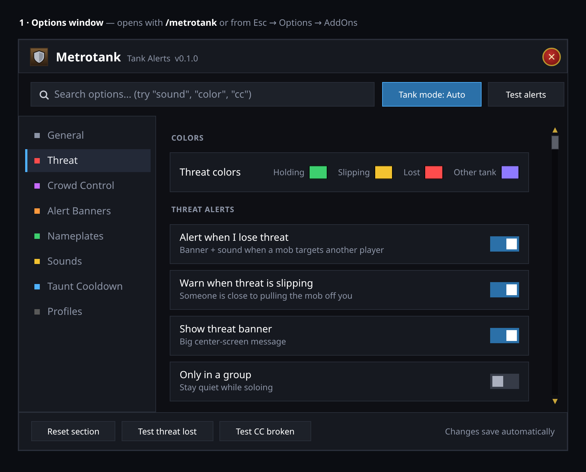
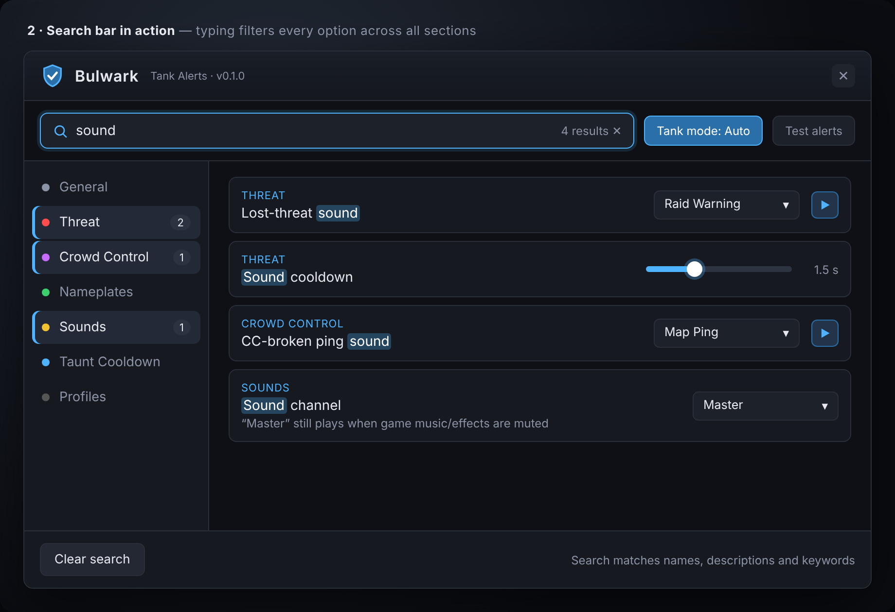

## Installation Instructions 

1. Download the repo (blue **Code** button → **Download ZIP**) and unzip it.
2. Rename the folder to exactly **`Metrotank`** (GitHub adds `-main` to the end and must be deleted).
3. Move the `Metrotank` folder to:
   Windows: `World of Warcraft\_forever_\Interface\AddOns\`
   Linux users using Proton (Steam): `.steam/steam/compatdata/(number associated with World of Warcraft)/pfx/drive_c/Program_Files(x86)/World_of_Warcraft/_forever/Interface/AddOns/Metrotank
4. Start the game. On the character screen, open **AddOns** and make sure Metrotank is checked.
**Note: If these instructions do not work, please provide feedback. 

This addon currently is NOT supported on Curseforge, Wago, WoWup etc. Updates to the addon will appear in this Github repository (https://github.com/MetrobusDesigns/Metrotank).

# Metrotank — Tank Alerts for WoW Forever

Metrotank is a tank add-on for **World of Warcraft: Forever** designed to give an audio cue when threat is lost on an enemy mob. In addition to this, Metrotank also contains three additional features:

1. **Threat lost:** By default, a sound and a banner is used when a mob that originally targets the tank targets another player. 
2. **CC broken:** A pinging sound and an orange plate is when crowd control(CC) (Sheep, Sap, Shackle, Trap…) ends early or is broken.
3. **Nameplate colors (Beta):** There is a basic function for slightly modified Blizzard nameplates in the "Nameplates" tab. Green is for (targeting the tank), yellow (threat is slipping), red (threat is lost), purple (other or off-tank), violet (CC'd), orange (CC broken).

> The images are preliminary designs and the options are subject to change. 

---

 

### If the addon shows as "Out of date"
- Re-download the addon from this Github repository (https://github.com/MetrobusDesigns/Metrotank)
OR 

- Type this in chat: `/dump select(4, GetBuildInfo())`
 - Put the number it prints on the first line of `Metrotank.toc` (`## Interface: 16001`).

---
## Options Window

-- There are over 100+ sounds to choose from. Many of the buttons are self-explanatory and can be toggled on and off. 
-- The tank dialogue box warnings can be moved and resized in the "Alert Banners" tab. 
---
## Commands

| While in-game, type in the chat area |
|---|---|
| `/metrotank` or `/mtk` | Open or close the options window |
| `/metrotank test` | Preview the threat-lost banner and sound |
| `/metrotank test cc` | Preview the CC-broken banner and ping |
| `/metrotank unlock` | Drag the banners somewhere else. Type it again to lock them. |
| `/metrotank debug` | Print what the addon sees to chat (useful when testing) |
| `/metrotank reset` | Put every setting back to default |

Tip: target an enemy before `/metrotank test` to preview the colors on its nameplate.

---

## How it works 

WoW Forever uses the same addon rules as retail **Midnight**. Inside dungeons and raids,
some combat values are **"secret"**: an addon can *show* them but can't *read* or compare them.

| Feature | Open world | Dungeons / raids |
|---|---|---|
| Plate colors (hold / slip / lost) | ✅ | ✅ |
| "Other or off-tank has it" color | ✅ | ⚠️ shows as "lost" |
| Threat-lost **sound + banner** | ✅ | ✅ on your **target**, ⚠️ maybe not on other mobs |
| CC ended ping | ✅ "broken" vs "expired" | ✅ but only "CC ENDED" (can't tell why) |
| Taunt cooldown on banner | ✅ | ✅ swipe shows; "ready" text may not |

The old combat log event (`COMBAT_LOG_EVENT_UNFILTERED`) is no longer available to addons, so CC
tracking uses the new `HARMFUL|CROWD_CONTROL` aura filter instead.

---

## Testing checklist for beta testers

- [ ] Addon loads with no red error (install **BugSack + BugGrabber** to catch errors)
- [ ] `/metrotank` opens the window; the search filters rows
- [ ] Open world: pull a mob, let a friend out-threat you → red plate + sound + banner
- [ ] Open world: friend sheeps(CC's) a mob, you hit it → orange plate + 2 pings + "CC BROKEN"
- [ ] Dungeon: plates still change color in combat
- [ ] Dungeon: `/metrotank debug` and note what prints when you lose threat
- [ ] Works with your nameplate addon (Blizzard, Plater, Platynator, EllesmereUI)

---

## Files

| File | Job |
|---|---|
| `Metrotank.toc` | Tells WoW the addon's name, version and which files to load |
| `Core.lua` | Settings, events, slash commands, tank detection |
| `Alerts.lua` | Sounds, banners and the taunt icon |
| `Nameplates.lua` | Colored border, icon and label on each enemy plate |
| `Threat.lua` | Reads threat and spots when you lose a mob |
| `CrowdControl.lua` | Watches CC auras and pings when they end |
| `Options.lua` | The options window and search bar. **Add new options here.** |

## License
MIT. See `LICENSE`.
