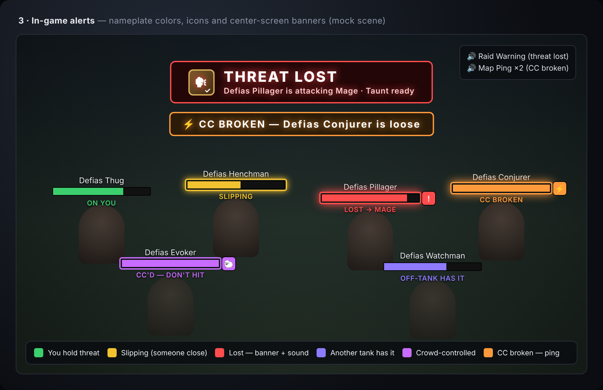

# Metrotank — Tank Alerts for WoW Forever

Metrotank is a tank addon for **World of Warcraft: Forever**. It does three things:

1. **Threat lost:** a sound and a banner when a mob turns away from you, plus nameplate colors.
2. **CC broken:** a ping sound and an orange plate when crowd control (Sheep, Sap, Shackle, Trap…) ends early.
3. **Nameplate colors:** green (holding), yellow (slipping), red (lost), purple (other tank), violet (CC'd), orange (CC broken).

The options window has a **search bar**: type `sound`, `color` or `cc` to find any setting.

> The images are design mockups. The real in-game window uses the same layout.

---

## Install (for testing)

1. Download this repo (green **Code** button → **Download ZIP**) and unzip it.
2. Rename the folder to exactly **`Metrotank`** (GitHub adds `-main` to the end).
3. Move it to:
   `World of Warcraft\_forever_\Interface\AddOns\Metrotank`
   *(Check which `_something_` folder WoW Forever created on your PC. Don't guess: open it and look.)*
4. Inside it you should see `Metrotank.toc` straight away, not another folder.
5. Start the game. On the character screen, open **AddOns** and make sure Metrotank is checked.

### If the addon shows as "Out of date"
Type this in chat: `/dump select(4, GetBuildInfo())`
Put the number it prints on the first line of `Metrotank.toc` (`## Interface: 16001`).

---

## Commands

| Command | What it does |
|---|---|
| `/metrotank` or `/mtk` | Open or close the options window |
| `/metrotank test` | Preview the threat-lost banner and sound |
| `/metrotank test cc` | Preview the CC-broken banner and ping |
| `/metrotank unlock` | Drag the banners somewhere else. Type it again to lock them. |
| `/metrotank debug` | Print what the addon sees to chat (useful when testing) |
| `/metrotank reset` | Put every setting back to default |

Tip: target an enemy before `/metrotank test` to preview the colors on its nameplate.

---

## How it works (and its limits on WoW Forever)

WoW Forever uses the same addon rules as retail **Midnight**. Inside dungeons and raids,
some combat values are **"secret"**: an addon can *show* them but can't *read* or compare them.

| Feature | Open world | Dungeons / raids |
|---|---|---|
| Plate colors (hold / slip / lost) | ✅ | ✅ (the game colors them for us) |
| "Other tank has it" color | ✅ | ⚠️ shows as "lost" |
| Threat-lost **sound + banner** | ✅ | ✅ on your **target**, ⚠️ maybe not on other mobs |
| CC ended ping | ✅ "broken" vs "expired" | ✅ but only "CC ENDED" (can't tell why) |
| Taunt cooldown on banner | ✅ | ✅ swipe shows; "ready" text may not |

The old combat log event (`COMBAT_LOG_EVENT_UNFILTERED`) is no longer available to addons, so CC
tracking uses the new `HARMFUL|CROWD_CONTROL` aura filter instead.

---

## Testing checklist

- [ ] Addon loads with no red error (install **BugSack + BugGrabber** to catch errors)
- [ ] `/metrotank` opens the window; the search filters rows
- [ ] Open world: pull a mob, let a friend out-threat you → red plate + sound + banner
- [ ] Open world: friend sheeps a mob, you hit it → orange plate + 2 pings + "CC BROKEN"
- [ ] Dungeon: plates still change color in combat
- [ ] Dungeon: `/metrotank debug` and note what prints when you lose threat
- [ ] Works with your nameplate addon (Blizzard, Plater, Platynator, EllesmereUI)

---

## Files

| File | Job |
|---|---|
| `Metrotank.toc` | Tells WoW the addon's name, version and which files to load |
| `Core.lua` | Settings, events, slash commands, tank detection |
| `Alerts.lua` | Sounds, banners and the taunt icon |
| `Nameplates.lua` | Colored border, icon and label on each enemy plate |
| `Threat.lua` | Reads threat and spots when you lose a mob |
| `CrowdControl.lua` | Watches CC auras and pings when they end |
| `Options.lua` | The options window and search bar. **Add new options here.** |

## License
MIT. See `LICENSE`.
